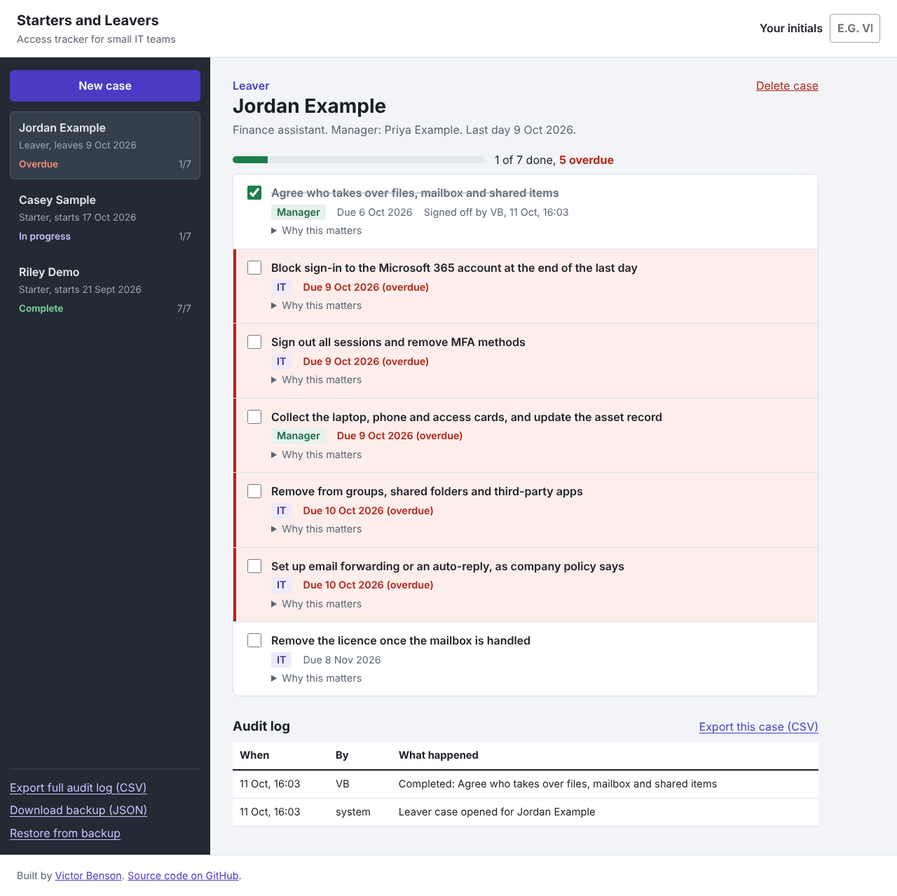
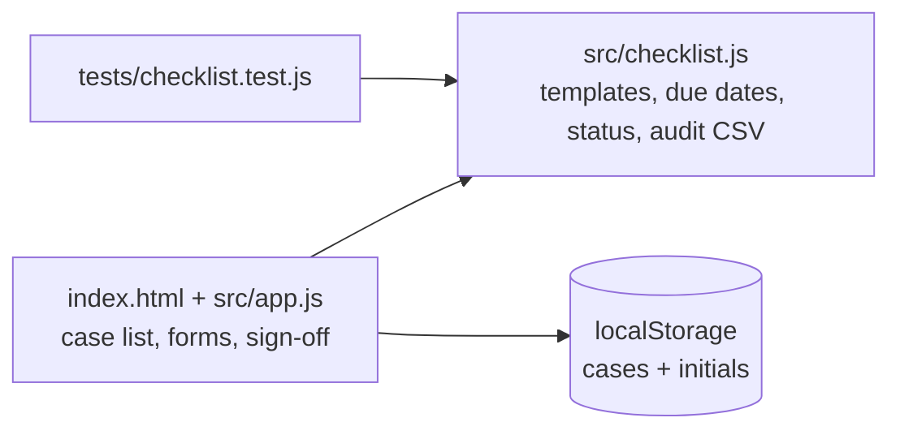

# Starters and Leavers: Access Tracker

[](https://github.com/macroer16/employee-access-checklist/actions/workflows/test.yml)

A tracker for small IT teams to make sure every step is done when someone joins or leaves: creating and removing Microsoft 365 access, MFA, devices and licences. Each task has an owner and a due date, sign-off is recorded, and everything goes into an audit log you can export.

**[Try it live](https://macroer16.github.io/employee-access-checklist/)** (click "Load 3 example cases" to see it in action)



## The problem

When someone leaves, their account often stays active for days or weeks. That's one of the easiest ways for an ex-employee or an attacker to get in. When someone joins, they're often given more access than they need. In small companies this is usually tracked in someone's head or an email thread, so steps get missed and nobody can prove what was done.

## What it does

- **One case per person:** open a case for a starter or a leaver with their role, manager and start date or last day.
- **Ready-made task lists** based on Microsoft 365 good practice: 7 starter tasks (approval, account, licence, least-privilege groups, secure device, MFA, security induction) and 7 leaver tasks (handover, block sign-in, revoke sessions and MFA, collect devices, remove groups and apps, mail forwarding, remove the licence).
- **Owners and due dates:** each task is assigned to IT or the manager and is due a set number of days before or after the key date. For example, blocking sign-in is due on the last day itself.
- **Overdue alerts:** overdue tasks are highlighted, and overdue cases go to the top of the list.
- **Sign-off with initials:** you can't tick a task without entering your initials. The time and person are recorded.
- **Audit log:** every case opened, task completed or task reopened is logged. Export one case or everything as CSV for an audit.
- **Backup and restore:** download all cases as JSON and restore them later.
- **Private:** everything is stored in your browser only. It doesn't connect to Microsoft 365. It records what was done, so use test names.

## How it's built



- **`src/checklist.js`**: all the rules, as pure functions with no browser code: templates, due-date maths, sign-off, progress, overdue checks, sorting and CSV export. Functions return a new case instead of changing the old one, which keeps the audit log trustworthy and makes testing simple.
- **`src/app.js`**: the interface. It renders the list and the case, handles the forms, and saves to localStorage.
- **No frameworks or build step:** plain JavaScript modules on GitHub Pages.

## Run it locally

```bash
git clone https://github.com/macroer16/employee-access-checklist.git
cd employee-access-checklist
python3 -m http.server 8000
# open http://localhost:8000
```

## Tests

```bash
npm test
```

There are 14 tests covering date maths across month and year boundaries, case creation and validation, sign-off rules, reopening, progress, overdue detection, case status and sorting, and CSV escaping (commas, quotes and new lines). GitHub Actions runs them on every push.

## Limitations

- It records what people say they did. It doesn't make the changes in Microsoft 365 or check them.
- Data lives in one browser, so use the backup to move it. There's no shared database or login yet.
- The task lists are fixed. Companies would want to edit them.

## What I learned

_TODO (Victor writes this)_

## Next steps

- [ ] Connect to Microsoft Graph (in a test Entra ID tenant) so blocking sign-in and removing groups actually happen, and are checked
- [ ] Editable task templates per department
- [ ] A shared backend so a whole team sees the same cases

Built by [Victor Benson](https://macroer16.github.io/victor-cloud-portfolio/).
